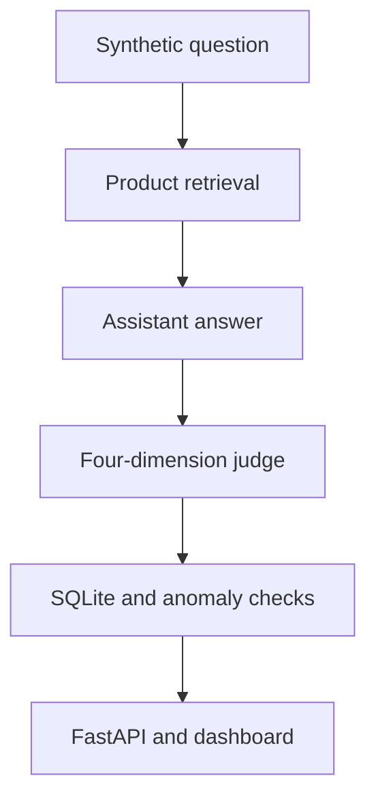

# Rufus Eval Engine

An independent portfolio prototype for evaluating a **simulated shopping assistant**.
It combines product retrieval, generated answers, a four-dimension LLM judge,
adversarial queries and a dashboard.

This project is not affiliated with Amazon and does not connect to the production
Amazon Rufus service. The bundled catalogue and evaluation queries are synthetic
project data. Professional employment experience is separate from this repository.

## Implemented Scope

- FAISS product retrieval using `all-MiniLM-L6-v2` embeddings and an
  `IndexFlatL2` index. Results are ordered by ascending squared L2 distance.
- Separate assistant and judge agents, with fixture-based mock mode and an
  optional Anthropic API path.
- Helpfulness, accuracy, hallucination and safety scores, each on a 0–10 scale.
  A higher hallucination score means fewer inventions.
- SQLite persistence, category-level score anomaly checks and adversarial summaries.
- FastAPI endpoints and Next.js screens for overview, answers, weak spots,
  adversarial categories and dataset browsing.

The judge's overall score uses weights of 30% helpfulness, 30% accuracy,
30% hallucination and 10% safety. These are project design choices, not a
validated industry benchmark.



## Mock and Live Modes

| Mode | Behaviour | What it demonstrates |
|---|---|---|
| Mock, the default | Returns fixed answer/judge fixtures; known adversarial categories receive scripted score changes | Application wiring and output contracts |
| Live, explicit opt-in | Calls the configured Anthropic model for the assistant and judge | A model-based evaluation experiment requiring separate validation |

**Mock scores do not measure assistant quality.** The mock answer is fixed even
when the question or retrieved products change. Scripted adversarial failures are
fixtures, not discovered model vulnerabilities. Do not present their scores or
failure rates as empirical findings.

Mock mode disables Anthropic requests; it does **not** disable embedding retrieval.
The full pipeline may download the sentence-transformer model on first use and
build a local index. The focused checks below avoid that path.

## Local Setup

Use Python 3.11 and Node.js 22. Run backend commands from the **repository root**.

```bash
python -m venv .venv
# macOS/Linux:
source .venv/bin/activate
# Windows PowerShell instead:
# .venv\Scripts\Activate.ps1
python -m pip install -r backend/requirements.txt
cp backend/.env.example .env
```

Keep `USE_MOCK=true` in the local `.env`; an API key is unnecessary for mock
agents. Do not commit a populated `.env` file. In PowerShell, use
`Copy-Item backend/.env.example .env` instead of `cp` if preferred.

Start the backend, still from the repository root:

```bash
python -m uvicorn backend.main:app --reload --host 127.0.0.1 --port 8000
```

Open the API documentation at `http://127.0.0.1:8000/docs`.

In a separate terminal:

```bash
cd frontend
npm ci
npm run dev
```

Open `http://localhost:3000`. The client defaults to the backend on port 8000;
set `NEXT_PUBLIC_API_URL` for a different API base URL. This value is public
browser configuration and must never contain a credential.

## Running the Full Mock Pipeline

From the repository root, with the backend dependencies installed:

```bash
python backend/scripts/run_eval.py --mock --limit 10
```

The option is `--limit`, not `--count`. This command writes evaluation results
to the local SQLite database. The pipeline creates a missing FAISS index; an
explicit `python backend/scripts/build_index.py` also rewrites the embeddings
in `backend/data/products.json`. Review those local changes before committing.

Live evaluations require a local API key and an explicit `USE_MOCK=false`
setting. They incur provider charges; no fixed per-question cost is promised.
Do not supply credentials to CI. Live model results need their own run provenance,
dataset/version record and quality assessment.

## Focused Validation

### Frontend

```bash
cd frontend
npm ci
npm run typecheck
npm run lint
npm test -- --ci --runInBand
npm run build
```

TypeScript and lint failures are enabled in production builds. A build also uses
`next/font/google`, so it may need network access for the font.
The component tests mock chart rendering; they do not validate visual layout,
browser interaction with a live API or end-to-end service health.

### Offline Agent Contracts

These focused tests do not import FAISS, load embeddings, invoke paid models or
write the evaluation database. They need only the two agent dependencies:

```bash
python -m pip install anthropic==0.20.0 python-dotenv==1.0.0
python -m unittest discover -s tests/offline -v
```

They check mock-mode selection, response metadata, scripted adversarial behaviour,
judge parsing and weighted scoring. The full `backend/tests` suite has additional
requirements, including pytest/pytest-asyncio, database fixtures and a built FAISS
index. Passing the focused suite does not establish that the full suite passes.

GitHub Actions runs the frontend checks and focused agent contracts on pull
requests and pushes to `main`. Its result is a check to inspect, not a claim that
every deployment or evaluation path has been tested.

## Evidence and Limitations

- This is a personal prototype, not a production Amazon system or a deployed
  customer service.
- A live frontend/API pair has not been independently verified. Deployment
  configuration in `render.yaml` is preparation, not a deployment receipt.
- LLM-judge assessments are not human-labelled ground truth. Agreement,
  calibration, bias and judge/assistant model dependence need evaluation.
- The SQLite file committed under `backend/data` should not be treated as a
  verified experiment log without reviewing its provenance and run mode.
- Dependency security, public API authentication/rate limits and production
  controls require a separate review before hosting.
- No repository licence has yet been established. Verify reuse rights and
  third-party notices before redistributing source or data.

Phase notes under `docs/` record development history. The current implementation
and reproducible check results take precedence over historical completion claims.
