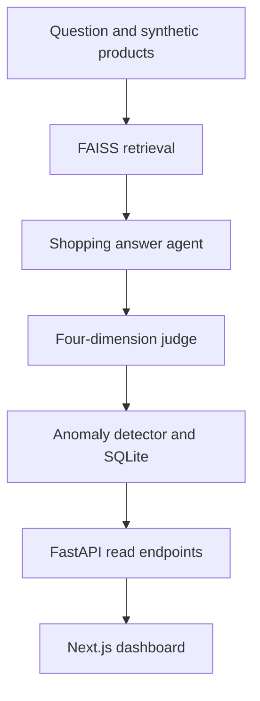

# Rufus evaluation system

Maintenance review: **11 November 2026**. Inspected base commit: `847d2934034498f17969a6c2802cd255e57adf69`.

Independent synthetic shopping-assistant evaluation prototype. Mock fixture scores are simulated outputs; they do not measure a commercial assistant.

## Current implementation

| Source boundary | Responsibility and implementation status |
| --- | --- |
| `backend/retrieval/faiss_retriever.py` | Sentence-transformer embeddings and FAISS index loading/search. |
| `backend/agents/rufus_agent.py; backend/agents/judge_agent.py` | Static mocks by default; explicit live mode calls Anthropic. |
| `backend/evaluation/pipeline.py; backend/evaluation/anomaly.py` | Sequential batch orchestration and local result persistence. |
| `backend/routes; frontend/lib/api.ts` | Paginated dashboard API and browser transport. |

## Changes in this maintenance pass

Both async agent methods previously executed synchronous SDK network calls directly on the event loop. They now await `asyncio.to_thread` while preserving the existing SDK and mock contracts. The SDK has a 30-second request timeout and two retries, and its HTTP transport is pinned to the compatible httpx 0.27.2 API; a constructor regression catches the former `proxies` argument failure without making network calls. A blocked-SDK regression checks that another coroutine can run before the SDK worker returns. The frontend migrates Next.js and its ESLint configuration from 14.1.0 to 15.5.29 with a regenerated lockfile. This version is beyond the patched floors in the October 2026 upstream [image-optimization advisory](https://github.com/vercel/next.js/security/advisories/GHSA-2464-fhr4-w9xw) and [Server Actions advisory](https://github.com/vercel/next.js/security/advisories/GHSA-p3m5-59mp-jv5r). Migration compatibility is checked with type generation, typecheck, lint, component tests and build. The compatible PostCSS 8 dependency is overridden to the patched version range, and its nanoid/source-map-js transitives are refreshed. Production dependency audit is separate from functional checks and is not a blanket security guarantee.

## Verification and repeatable checks

`python -m unittest discover -s tests/offline -v` checks fixtures and both live-path thread handoffs without a key, model download or DB mutation. Existing frontend CI also runs typecheck, lint, tests and build.

Record the exact commit and hosted workflow result when reviewing a change. Passing a focused regression does not establish end-to-end reliability or measured capacity.

## Scale and ownership decisions

These are explicit **future design steps**, not implemented infrastructure or measured capacity claims.

| Pressure or boundary | Decision and next evidence |
| --- | --- |
| Model calls | Move to an async SDK with explicit deadlines, bounded concurrency and provider rate budgets after measuring queue wait and token use. |
| Results | Introduce job IDs and idempotent writes; migrate to a managed relational database before multiple evaluator workers write concurrently. |
| Retrieval | Version the product/index snapshot together. Measure embedding and search latency before choosing a shared retrieval service. |

Keep one owner for each data contract, centralize paths/configuration, and review dependency changes with the smallest relevant regression suite. Separate computed results from static fixtures; version inputs with artifacts. Before release, reproduce setup from a clean checkout and check both failure paths and resource cleanup.

## Operational limits and recovery

Retrieval is still synchronous; the batch path is sequential; SQLite is a single local store; thread cancellation does not abort an already running SDK request. Live credentials, retrieval-model availability, judge schema validation and hosted deployment require separate verification.

Keep a known-good commit and backup mutable experiment artifacts before running migrations or training. On failure, preserve the error and input/configuration version; restore the prior artifact set or checkout the known-good code before retrying. No cloud deployment, paid service provisioning, data migration or production-scale load test was performed by this maintenance pass.
